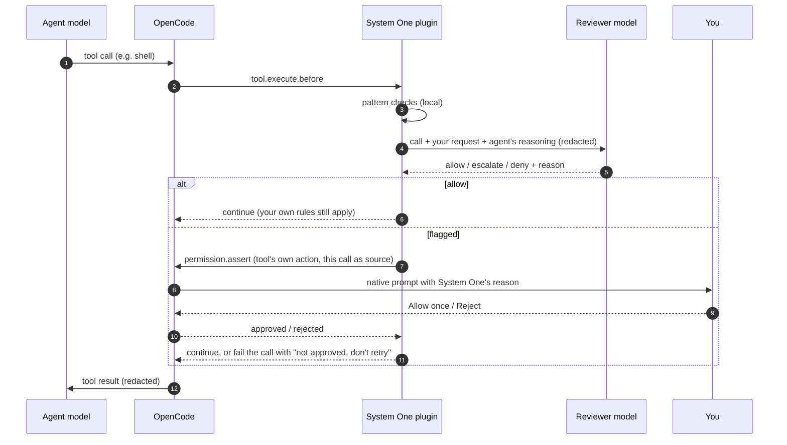

# How it works

This page explains what the plugin hooks into, how a decision is made, and the guarantees it keeps. For setup,
see the [README](../README.md); for every option, see [configuration.md](./configuration.md).

## The OpenCode hooks it uses

The plugin is built on the OpenCode v2 plugin API (`@opencode/plugin` ≥ 2.2) and uses only public hooks:

| Hook                      | Used for                                                                               |
| ------------------------- | -------------------------------------------------------------------------------------- |
| `tool` → `execute.before` | Review **every** tool call before it runs: built-in, MCP and custom tools.             |
| `permission.assert()`     | Raise OpenCode's **native permission prompt** for a flagged call and wait for you.     |
| `permission` → `evaluate` | Make sure that prompt is shown even if your rules would auto-allow; attach the reason. |
| `tool` → `execute.after`  | Redact secrets from output; optionally review output for prompt injection.             |
| `session` → `prompt`      | Remember your latest request, as context for the reviewer.                             |
| `event.subscribe()`       | Read the agent's reasoning live (`session.reasoning.*`), joined to each call.          |
| `shell` → `create.before` | Remove the reviewer's API key from every shell the agent starts.                       |
| `experimental.generate`   | Run the reviewer on one of your OpenCode models (`opencode` backend).                  |

## Reviewing a call



1. **Pattern checks** run locally and instantly: known secret formats and well-known dangerous command shapes.
   They work even with no reviewer model, and keep working if the reviewer is down.
2. **The System One model** gets the call, your latest request, the agent's reasoning for this call and the
   earlier calls in this turn. It answers with a decision, risk categories and a one-line reason.
3. **The strictest finding wins:** `deny` > `escalate` > `allow`. If the reviewer fails, `failMode` decides
   (default: ask you).

## Raising the native prompt

A flagged call is escalated with `permission.assert` under **the tool's own permission action** (`shell`,
`edit`, `webfetch`, …) and with **the tool call as the source**. OpenCode therefore renders the same rich card
it would for that call (command, diff, URL), and System One's reason travels as the request message, which
also drives OpenCode's desktop notification.

The `permission.evaluate` hook then:

- **forces the prompt** for System One's own request, even if your config would allow the action;
- **never relaxes your rules.** Your `ask` rules still prompt, your `deny` rules still block. The one exception
  is de-duplication: once you've approved a flagged call, the tool's own request for _that same call and
  action_ isn't asked a second time. Different actions, e.g. `external_directory`, still prompt.

The request carries no "save" patterns, so "Always allow" can't whitelist future flagged calls; each one is
reviewed again.

> **Note on Reject.** A plugin's prompt is raised from inside `tool.execute.before`, so a rejection reaches the
> agent as a failed tool call with an explicit "not approved, don't retry, ask how to proceed" message. It
> doesn't stop the whole step, as rejecting a built-in prompt does.

## Reasoning context

OpenCode publishes the agent's reasoning as live events tagged with the assistant message id, the same id the
tool hook receives as `messageID`. The plugin subscribes to them and joins each call to the reasoning that
produced it. If a call arrives while that reasoning is still streaming, the review waits up to
`reasoningWaitMs`. Long traces keep their end, the part closest to the action.

This lets the reviewer catch a `reasoning_mismatch`, for example a trace saying "no tools are needed" followed
by a tool call. Reasoning is treated as evidence, never as a control: decisions are always enforced at the
tool call.

## Tool output

After a tool runs:

1. **Redaction** (on by default): known token formats, whole PEM private-key blocks, JWTs and
   `NAME=value`-style credentials (keeping the name) are replaced with `[REDACTED:…]`. References and
   placeholders (`${API_KEY}`, `process.env.X`, `<your-key>`) and look-alikes (`max_tokens=…`, git hashes) are
   left alone. Only existing text fields that actually contained a secret are rewritten.
2. **Prompt-injection review** (opt-in, `reviewOutput`): blatant injection markers plus the reviewer model with
   a dedicated prompt. Content that merely _discusses_ prompt injection is allowed. A flagged output goes to the
   same native prompt, shown as "output of &lt;tool&gt;":
   - **Allow once:** the agent gets the output prefixed with a note to treat it strictly as data.
   - **Reject:** the agent gets a "withheld" notice and none of the original output.

## Protecting the reviewer itself

- **Untrusted content is fenced** with per-request random markers, and forged markers inside the content are
  neutralised, so a command or web page can't close the fence and talk to the reviewer.
- **Everything is redacted before review,** so the guard never forwards the secrets it protects.
- **`SYSTEMONE_API_KEY` is read once and deleted** from the process environment, and stripped again from every
  shell, so `echo $SYSTEMONE_API_KEY` from the agent prints nothing.

## Source layout

```
src/
  plugin.ts         OpenCode v2 plugin: hooks, native escalation, redaction, env scrubbing
  guard.ts          combines pattern findings and the model verdict
  heuristics.ts     pattern checks for calls; secret redaction
  reviewer.ts       reviewer prompt, response parsing, transports (opencode / http)
  output-review.ts  prompt-injection review of tool output
  reasoning.ts      joins live reasoning events to tool calls
  audit.ts          JSONL audit trail
  config.ts         options + environment → config; secret env capture
  types.ts, log.ts, index.ts (package entry), core.ts (library exports)
test/
  *.test.ts         unit + plugin-flow tests against a faithful fake OpenCode context
  e2e/              live tests against a real OpenCode CLI with a scripted model
task/               planned work that isn't implemented yet
```
